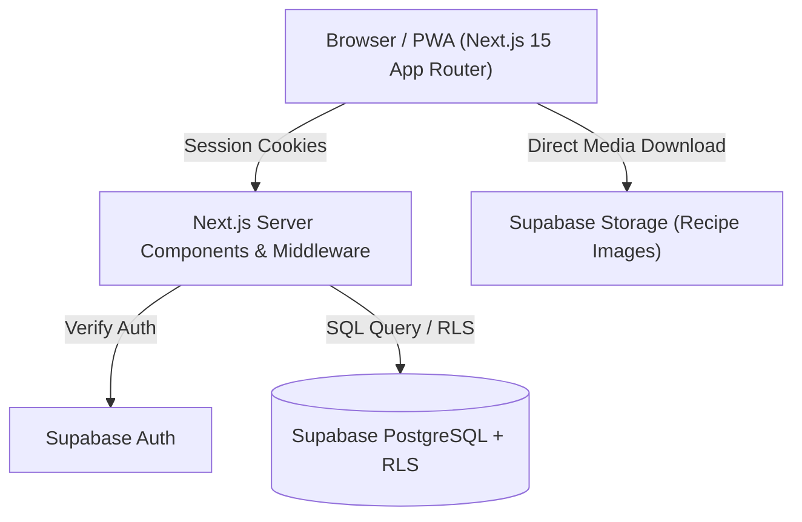

# Nana's Recipes (Recepti)

Private household cookbook Progressive Web App (PWA) built with Next.js 15 & Supabase, featuring pantry ingredient matching and Row-Level Security.


## Overview

**Nana's Recipes** is a household cookbook application designed for meal planning, family recipe archiving, and pantry management. Built with Next.js 15 (App Router) and Supabase, it supports multi-owner authorization, pantry ingredient matching (finding recipes based on ingredients you already have), step-by-step cooking execution mode, and offline PWA functionality.

## Key Features

* **Pantry Ingredient Matching**: Enter available pantry items to immediately query matching recipes ranked by missing ingredients.
* **Multi-Owner Household Authorization**: Shared family households with fine-grained Supabase Row-Level Security (RLS) policies.
* **Step-by-Step Interactive Cooking Mode**: Fullscreen cooking interface with step progress tracking and scalable portion quantities.
* **Offline PWA Capabilities**: Service worker caching for offline recipe viewing in the kitchen.
* **Secure Image & Storage Management**: Supabase Storage buckets for uploading and serving recipe cover photos.

## Tech Stack

**Frontend Framework**
* Next.js 15 (App Router), React 19, TypeScript
* PWA Service Worker (`next-pwa` / custom worker)

**UI & Styling**
* Tailwind CSS, Radix UI primitives, Lucide React, Sonner toasts, Shadcn UI patterns

**Backend & Database**
* Supabase PostgreSQL, `@supabase/ssr`, `@supabase/supabase-js`
* Row-Level Security (RLS) & PostgreSQL Functions

**Quality & Testing**
* Vitest (Unit tests), Playwright (E2E tests), Prettier, ESLint

## Architecture



## Getting Started

### Prerequisites
* Node.js 18+
* pnpm

### Installation

1. Clone the repository:
   ```bash
   git clone https://github.com/flegardev/recepti.git
   cd recepti
   ```

2. Install dependencies:
   ```bash
   pnpm install
   ```

3. Set up environment variables:
   ```bash
   cp .env.example .env.local
   ```

4. Run the development server:
   ```bash
   pnpm dev
   ```

## Environment Variables

```env
NEXT_PUBLIC_SUPABASE_URL=https://your-project.supabase.co
NEXT_PUBLIC_SUPABASE_ANON_KEY=your-anon-key
SUPABASE_SERVICE_ROLE_KEY=your-service-role-key
```

## Development Commands

```bash
pnpm dev              # Start Next.js development server
pnpm build            # Build production package
pnpm typecheck        # Run TypeScript validation
pnpm test             # Run Vitest unit tests
pnpm test:e2e         # Run Playwright E2E tests
pnpm db:seed          # Seed database with sample recipes
```

## Deployment

Deployed on Vercel at [https://recepti-rho.vercel.app](https://recepti-rho.vercel.app).

## License

This project is open-source software.
